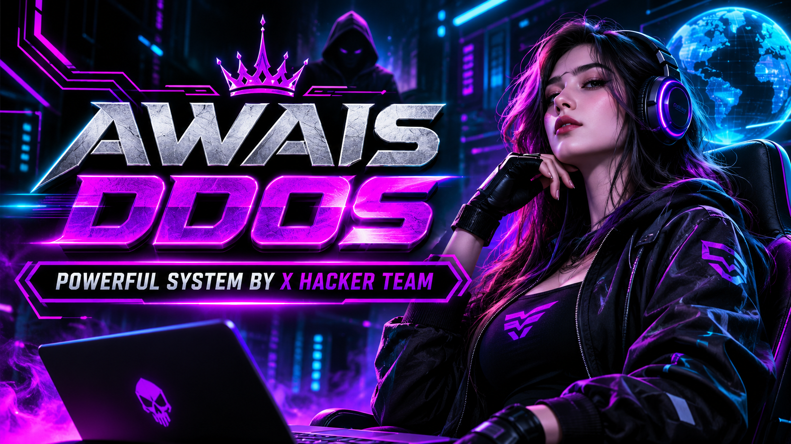

  
  

"CODE • TECHNOLOGY • API TESTING • CUSTOMIZATION"

DEVELOPED BY AWAIS X HACKER

---

🔴 PROJECT OVERVIEW

WELCOME TO AWAIS DDOS

A Python-based project combining its core Python functionality, API request testing and customizable website experience under one project identity.

⚡ ABOUT THE PROJECT

AWAIS DDOS is a project developed under the X HACKER TEAM identity.

The project focuses on Python-based functionality, API testing and website customization. It brings together development, network request testing and interface-related functionality in a single project environment.

The API testing aspect is intended to help examine requests and responses from authorized endpoints. The website customization aspect provides the project's web-facing visual experience.

This repository contains the project source and its associated resources.

🧬 PROJECT DETAILS

PROPERTY| INFORMATION
Project Name| AWAIS DDOS
Project Category| Python / API / Web
Main Source| "Awais.py"
Programming Language| Python
Repository| "ATTACK-"
Developer| AWAIS X HACKER
Organization| X HACKER TEAM
Banner Directory| "assets/"
Project Platform| GitHub

🚀 PROJECT HIGHLIGHTS

<b>🔴 PYTHON PROJECT ENGINE</b>
- Python-based source code.
- Terminal-based project execution.
- Project-specific functionality.
- Supporting resources and configuration.

<b>🌐 API REQUEST TESTING</b>
- Send requests to authorized API endpoints.
- Examine HTTP response codes.
- Inspect returned response data.
- Understand request and response behavior.
- Perform development and debugging tests.

<b>🎨 WEBSITE CUSTOMIZATION</b>
- Website visual customization.
- Interface presentation.
- Layout and styling.
- Project branding.
- Web-facing project experience.

<b>⚙️ PROJECT CONFIGURATION</b>
- Python environment setup.
- Dependency management.
- Source-code configuration.
- Project resource management.

---

🌐 API TESTING SYSTEM

API testing is an important part of the project's intended use.

An API allows different applications and services to communicate through requests and responses.

The API testing workflow involves selecting an authorized endpoint, sending a request and examining the response returned by the server.

API TESTING CONCEPTS

COMPONENT| DESCRIPTION
API Endpoint| Destination address
HTTP Request| Request sent to a server
GET| Retrieve information
POST| Submit information
Headers| Additional request information
Parameters| Request input values
Response| Data returned by server
Status Code| HTTP response status

HTTP RESPONSE REFERENCE

STATUS| MEANING
"200"| OK
"201"| Created
"400"| Bad Request
"401"| Unauthorized
"403"| Forbidden
"404"| Not Found
"429"| Too Many Requests
"500"| Internal Server Error

API REQUEST EXAMPLE

The following is an independent Python demonstration using a public HTTP testing endpoint, not a claim that this exact command is a built-in project menu option.

import requests

url = "https://httpbin.org/get"

try:
    response = requests.get(url, timeout=10)

    print("=" * 40)
    print("       AWAIS API TEST")
    print("=" * 40)

    print("Status:", response.status_code)
    print("Response:")

    print(response.text)

except requests.RequestException as error:
    print("Request Error:", error)

API TESTING WORKFLOW

       API TESTING
            |
            v
    SELECT ENDPOINT
            |
            v
     SEND REQUEST
            |
            v
    RECEIVE RESPONSE
            |
            v
     CHECK STATUS
            |
            v
    EXAMINE RESPONSE
            |
            v
       TEST RESULT

---

🎨 WEBSITE CUSTOMIZATION

The website component is another important part of the project.

Its purpose is to provide a customizable interface and a visual presentation for the available project functionality.

CUSTOMIZATION AREAS

AREA| PURPOSE
Theme| Visual appearance
Colors| Interface color scheme
Typography| Text presentation
Layout| Content arrangement
Branding| Project identity
Responsive Design| Different screen sizes
Navigation| Interface organization

DESIGN OBJECTIVES

- Clean interface presentation.
- Consistent project branding.
- Organized content.
- Easy navigation.
- Responsive visual layout.
- Professional appearance.

---

💻 INSTALLATION GUIDE

STEP 01 — INSTALLATION REQUIREMENTS

Prepare the following:

- Python 3
- Git
- Terminal or command prompt
- Internet connection
- Required Python dependencies

STEP 02 — CLONE THE REPOSITORY

git clone https://github.com/awaiscybergang/ATTACK-.git

STEP 03 — ENTER PROJECT DIRECTORY

cd ATTACK-

STEP 04 — CHECK PYTHON

python --version

Alternative:

python3 --version

STEP 05 — INSTALL DEPENDENCIES

If the repository includes "requirements.txt":

pip install -r requirements.txt

STEP 06 — START THE PROJECT

python Awais.py

Alternative:

python3 Awais.py

---

📱 TERMUX INSTALLATION

UPDATE TERMUX

pkg update && pkg upgrade -y

INSTALL PYTHON AND GIT

pkg install python git -y

CLONE PROJECT

git clone https://github.com/awaiscybergang/ATTACK-.git

OPEN PROJECT

cd ATTACK-

INSTALL DEPENDENCIES

pip install -r requirements.txt

Run this step only if the repository contains that file.

EXECUTE PYTHON FILE

python Awais.py

---

🐧 LINUX INSTALLATION

sudo apt update && sudo apt upgrade -y

sudo apt install python3 python3-pip git -y

git clone https://github.com/awaiscybergang/ATTACK-.git

cd ATTACK-

pip3 install -r requirements.txt

python3 Awais.py

---

🪟 WINDOWS INSTALLATION

Open PowerShell or CMD.

CLONE REPOSITORY

git clone https://github.com/awaiscybergang/ATTACK-.git

OPEN PROJECT DIRECTORY

cd ATTACK-

INSTALL DEPENDENCIES

python -m pip install -r requirements.txt

RUN PROJECT

python Awais.py

---

📂 PROJECT RESOURCES

The banner image is referenced from the assets folder:

assets/awais-ddos-banner.png

The main project source:

Awais.py

Repository:

https://github.com/awaiscybergang/ATTACK-

---

🛠 TROUBLESHOOTING

<b>❌ Python Command Not Found</b>
Check your Python installation:

python --version

Try:

python3 --version

<b>❌ Module Not Found</b>
If a requirements file exists, install dependencies:

pip install -r requirements.txt

<b>❌ Git Command Not Found</b>
Check:

git --version

Install Git for your operating system.

<b>❌ API Request Failed</b>
Check:

- Internet connectivity.
- Endpoint address.
- Request method.
- Authentication.
- Server availability.
- Request timeout.

<b>❌ Banner Image Not Showing</b>
Check that the image exists at:

assets/awais-ddos-banner.png

GitHub paths are case-sensitive. The filename and directory must match exactly.

---

🔐 SECURITY & RESPONSIBLE USE

This project should only be used in authorized environments.

- Test only APIs and systems you own or have permission to assess.
- Do not disrupt third-party services.
- Never perform unauthorized denial-of-service activity.
- Protect private credentials and API keys.
- Respect applicable laws and service policies.

Disclaimer: The developer is not responsible for unauthorized use or misuse of this project.

---

👑 DEVELOPER INFORMATION

  

⚡ AWAIS X HACKER

POWERED BY X HACKER TEAM

INDEPENDENT DEVELOPMENT • TECHNOLOGY • PROGRAMMING

   

  

<a href="https://github.com/awaiscybergang/ATTACK-">
**⭐ EXPLORE THE REPOSITORY**
</a> SUPPORT • LEARN • BUILD • EXPLORE

---

🔴 X HACKER TEAM 🔴

POWERED BY AWAIS X HACKER

"© 2026 AWAIS X HACKER TEAM"

